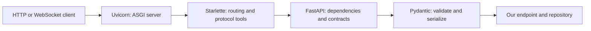

# 1. Foundations and choosing a framework

## What FastAPI provides

FastAPI builds API behavior from Python type annotations: input parsing and
validation, response contracts, dependency injection, and an OpenAPI schema.
Starlette supplies the web toolkit; Pydantic supplies the data layer. Uvicorn
runs the resulting ASGI application. These are separate responsibilities.
[Official overview](https://fastapi.tiangolo.com/).

This diagram shows responsibilities, not a precise function call stack. In this
app, `main.py` constructs the service, a router declares the operation, an input
model validates the body, and the repository manages records.

## Why it fits a small backend

Our dependency choices are deliberate: `fastapi` without the optional standard
bundle, Pydantic because our code imports it directly, base Uvicorn, and a
WebSocket implementation. Development tools are separate extras. A JSON API
does not need an ORM, admin UI, template engine, task broker, or model framework
until a requirement calls for one. Required transitive packages are normal;
removing them would break the framework.

FastAPI is a framework, not a mandatory full application platform. It supports
additional capabilities without requiring every app to install them.
[FastAPI features](https://fastapi.tiangolo.com/features/).

## FastAPI versus Flask versus Django

| Decision | FastAPI | Flask | Django |
| --- | --- | --- | --- |
| Main approach | Typed API framework | Flexible web microframework | Broad web framework with integrated conventions |
| Server interface | ASGI | WSGI; async views available | WSGI or ASGI |
| Async | Native async handlers and sync handler adaptation | Async views can await I/O; a WSGI request still occupies its worker | Async request stack under ASGI; check middleware/ORM boundaries |
| Input/output contracts | Pydantic integration and OpenAPI generation | Usually assemble extensions or custom validation | Forms/models in core; API tooling such as DRF adds API contracts |
| Typical reason to choose | API service, typed Python team, I/O concurrency | Existing Flask expertise, flexible small web application | Admin, authentication, ORM, migrations and business application features |
| Main cost | You choose storage, identity and operations integrations | You assemble the API conventions | More framework conventions and features than a tiny service may need |

Flask **does** support `async def`; under its WSGI model, that does not turn it
into an ASGI concurrency model. Django **does** support async views and ASGI;
synchronous middleware or database operations can require adaptation. Avoid the
outdated interview answer that Flask and Django are simply synchronous.
[Flask async documentation](https://flask.palletsprojects.com/en/stable/async-await/),
[Django async documentation, version 5.2](https://docs.djangoproject.com/en/5.2/topics/async/).

For this project, FastAPI makes the request contracts visible in code and in
`/docs` while letting us keep the domain small. That is our design decision,
not evidence that it is universally faster or better. A Django app may save
more work if an admin-heavy product is the actual requirement.

## Vocabulary to remember

- **API**: a contract for interacting with the service.
- **Endpoint/path operation**: a path plus HTTP method, such as `POST /orders`.
- **Framework**: code that routes requests and calls our handlers.
- **Server**: code that listens on a socket and invokes the application.
- **Schema**: a machine-readable description of accepted or returned data.
- **Dependency injection**: asking the framework to supply a resource/value.
- **ASGI/WSGI**: interfaces between a Python application and a server.

Checkpoint: explain why installing FastAPI does not start a server, why a
Pydantic model is not a database table, and which Django features this app
would have to supply separately if it needed them.
