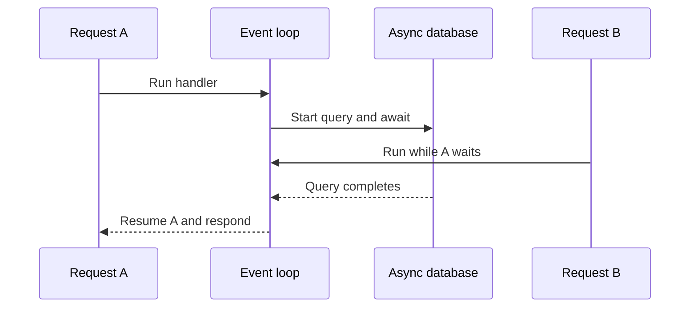

# 4. Async, WSGI and ASGI

## First separate three concepts

- **Concurrency**: multiple tasks make progress during overlapping periods.
- **Parallelism**: work runs at the same time on multiple execution resources.
- **Asynchronous I/O**: a task yields while an operation is waiting so the event
  loop can run another task.

An `async def` handler runs on the event loop. An `await` can yield control when
the awaited operation suspends; it is not a promise that every function will
yield. Making a function async does not make a blocking SDK, SQL driver, or CPU
loop cooperative.
[FastAPI concurrency guide](https://fastapi.tiangolo.com/async/).

## Choose the handler from the work

| Work | Reasonable starting point | Main risk |
| --- | --- | --- |
| Small in-memory operation | `async def` with short direct calls | Growing scans eventually monopolize the loop |
| Async HTTP/database client | `async def` and `await` | Missing timeouts, unbounded concurrency, pool exhaustion |
| Blocking I/O library | `def` route or explicitly offload the call | Thread capacity and underlying client thread safety |
| CPU-heavy Python | Worker process / external service when needed | Async syntax does not remove CPU work |
| GPU inference | Dedicated serving capacity with bounded requests | Device memory, batching, cancellation and scheduling |

FastAPI offloads **normal `def` endpoints and dependencies it invokes** to a
thread pool. It does not offload every normal function you call yourself.
If an async handler directly calls `requests.get(...)` or `time.sleep(...)`,
that call blocks its event loop. Starlette's shared thread capacity is finite
and can be shared with uploads, file responses and background tasks.
[Starlette thread pool](https://starlette.dev/threadpool/).

**Design sketch**, not existing endpoints:

```python
import asyncio
from starlette.concurrency import run_in_threadpool


async def use_async_client(client):
    return await client.get("https://example.com", timeout=3.0)


async def use_blocking_client(blocking_lookup, order_id):
    return await run_in_threadpool(blocking_lookup, order_id)


async def limited_operation(operation):
    async with asyncio.timeout(3):
        return await operation()
```

Offloading blocking I/O preserves event-loop responsiveness, but it still uses
a thread. Cancellation of an await does not necessarily terminate an operation
already running in a thread or on an external service. Carry deadlines into the
underlying client and design operations to be safe to retry.

## Run the lab

```bash
uv run --locked python examples/async_lab.py
```

Six cooperative waits of 0.05 seconds can overlap. Limiting concurrency to two
requires roughly three groups. Six blocking sleeps inside async functions
stall the loop and accumulate. Actual timings vary with scheduling; this is a
demonstration of waiting, not a framework benchmark.

In [repository.py](../app/repository.py), the tiny methods contain no awaits and
run directly on the same loop. That is why a create operation completes before
another request task can interrupt it. This argument no longer holds if you
move the repository to threads, add I/O, or use multiple worker processes.

## WSGI versus ASGI

| Concern | WSGI | ASGI |
| --- | --- | --- |
| Interface | Synchronous callable using `environ`, `start_response`; returns an iterable | Async callable using `scope`, `receive`, `send` |
| Interaction | HTTP request/response | Events for HTTP, WebSocket, and application lifespan |
| Waiting | Commonly occupies a thread/process or uses a server-specific concurrency strategy | Cooperative awaits allow a loop to handle other connections |
| WebSockets | Outside the standard WSGI interface | Defined protocol support |
| Streaming | Can yield response chunks | Can send/receive asynchronous event messages |
| Compatibility | Flask; Django WSGI entry point | FastAPI/Starlette; Django ASGI entry point |

These are application/server interfaces, not replacements for HTTP and HTTPS.
WSGI deployments can scale with threads/processes and can stream responses.
ASGI allows efficient cooperative I/O and bidirectional protocols, but blocking
application code still blocks its loop. Neither interface automatically makes
business operations correct or storage shared.
[WSGI specification](https://peps.python.org/pep-3333/),
[ASGI introduction](https://asgi.readthedocs.io/en/latest/introduction.html).



Checkpoint: explain why `asyncio.gather` with ten thousand operations is not
automatically safe, why ten workers can use ten model copies, and why a sync
helper called directly inside `async def` behaves differently from a `def`
endpoint called by FastAPI.
