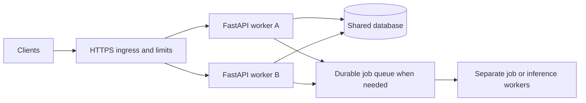

# 6. Scaling, reliability and deployment decisions

## Why this app must stay on one worker

Each process gets a new `OrderRepository` in lifespan. With two workers, a POST
handled by worker A changes only A's dictionary; a later GET on worker B may
return 404, an old value, or a different order with the same ID. Reload/restart
also recreates the seed data. An in-process lock would not fix this.

The current list endpoint scans and sorts the in-memory collection. A maximum
page size of 100 limits response size, not total memory, scan cost, or the
number of orders users can create. The project teaches contracts and request
handling; it does not claim production capacity.

## A path from local service to shared service



This is a design direction, not deployed infrastructure. First replace the
repository with durable storage, use database-generated IDs, define transactions
and uniqueness constraints, and test concurrent changes. Keep route contracts
stable where possible while changing persistence. Add more processes only
after state and resource assumptions are explicit.

| Bottleneck/failure | Measure first | Possible response |
| --- | --- | --- |
| Slow upstream I/O | Upstream latency and timeout rates | Async client, reuse connections, deadlines, bounded calls |
| Database saturation | Pool wait, query latency, query plans | Indexes, query changes, bounded pools, fewer connections |
| CPU saturation | CPU and event-loop lag | Move expensive work or add measured CPU capacity |
| Memory growth | RSS, payloads, caches, model size | Bounds, external storage, fewer model copies |
| Too many live sockets | Connection count, lag, buffered messages | Limits, backpressure, shared events, capacity planning |
| Duplicate writes after retries | Duplicate business actions | Idempotency keys backed by durable uniqueness/transactions |

## Workers and resource multiplication

Multiple worker processes have separate memory and lifespans. Four workers with
a pool of ten database connections can request around forty connections, before
overflow/other services. A model loaded in every worker may multiply RAM or
device usage; do not assume process copies share writable state or model memory.
[FastAPI deployment concepts](https://fastapi.tiangolo.com/deployment/concepts/).

Development uses `--reload`. Production uses a process/container supervisor and
an intentional worker/replica strategy. Uvicorn's reload and worker modes are
mutually exclusive. A single process per container with replicas is one option;
multiple local workers is another, once shared state is correct.
[Uvicorn settings](https://uvicorn.dev/settings/).

For this app, a non-reloading local run remains:

```bash
uv run --locked python -m uvicorn main:app --host 127.0.0.1 --port 8001
```

This command is not a public deployment recipe. Containerization alone would
not fix temporary storage or authentication. No deployment was performed as
part of this review.

## Lifetimes, failures and durable jobs

Use app lifespan for shared clients/pools and dependencies for per-request
sessions. Keep transactions small; close resources on exceptions. Database
clients need suitable async support or explicit sync adaptation. Migration
execution should be coordinated, rather than racing independently in every
worker's startup.

FastAPI `BackgroundTasks` executes work in the serving process after the
response. A crash can lose that work; it is not a durable queue. Use it for
small best-effort tasks. A long ingestion, retried email workflow, or costly
inference job often needs a job ID, durable state, a queue and separate workers.
[Background tasks](https://fastapi.tiangolo.com/tutorial/background-tasks/).

For competing order updates, define expected-state/version checks. Merely
validating a status string does not prevent lost updates or illegal transitions.
For retried creation, persist an idempotency key with a payload fingerprint and
result; an in-memory dictionary cannot provide cross-worker guarantees.

## Security and operability as requirements emerge

For a shared service, add identity verification and record-level authorization.
FastAPI security helpers can extract credentials and declare schemes in the
API contract; they do not provide a complete identity system or verify a JWT
merely by reading it. Validate signature, issuer, audience, expiry and applicable
permissions. Use a maintained identity integration when appropriate.
[Security tools](https://fastapi.tiangolo.com/tutorial/security/).

Terminate TLS correctly, trust only the intended proxy, restrict request sizes,
and define rate/concurrency limits. Keep secrets out of logs and error bodies.
`/health` here is liveness only; readiness should reflect whether required
resources can serve traffic, with appropriate deadlines. Observability should
include structured logs, latency distributions, error rates and dependencies.

## What a capacity test should establish

Define realistic payloads and traffic mix, dataset size, concurrent users,
acceptable p95/p99 latency and error budget. Test through the intended server
and deployment path, include slow dependencies, and watch CPU, memory, loop lag,
pool queues and upstream quotas. Check behavior under overload and shutdown.

The included 25-request concurrency test checks unique IDs in one process; it
does not establish throughput, production load capacity, or cross-worker safety.
Checkpoint: diagnose why adding workers could increase database errors while
making CPU utilization look healthier.
